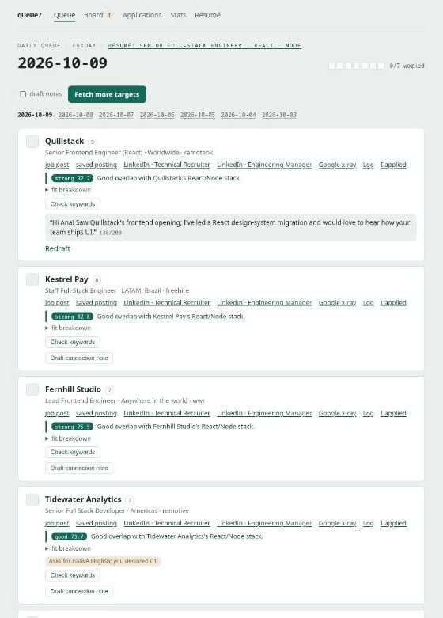

# simple-job-seeker

> **Work in progress** — under active development, expect rough edges and
> breaking changes.

Personal tooling for a remote job search: a Python pipeline that scores
jobs from remote boards into a daily queue with prebuilt LinkedIn search
links, plus a Chrome extension that scores whatever's on screen on the
LinkedIn feed or a Jobs page.

## Why

Automate the research, not the outreach. The click stays human — keeps the
account safe from bans. See `CLAUDE.md` for the exact rule.

## Demo

Mocked data, no real jobs, companies or people. The daily queue with a
card's résumé fit breakdown, ticking a card off and logging the
touchpoint, then the Board, Applications and the skill gaps on Stats:



Still: [the daily queue](docs/screenshots/daily-queue.png).

## Layout

- **`server/`** — Python pipeline: collection, scoring, SQLite state, web
  UI, outreach tracker. Stdlib only. See
  [`server/README.md`](server/README.md).
- **`extension/`** — Chrome extension (Manifest V3, no build step). Manual
  click reads the LinkedIn feed/Jobs page, POSTs to `server/`'s
  `/api/rate` for scoring; hits land in the same queue. Read-only against
  the page. See [`extension/README.md`](extension/README.md).

## Quick start

Run the server with Docker or tmuxinator, below. To run it directly with
Python, see [server/README.md](server/README.md#quick-start).

### With Docker

From the repo root:

```sh
docker compose up -d                                  # web UI at http://127.0.0.1:3000
docker compose run --rm web python3 queue_agent.py    # CLIs, same state
docker compose down
```

Compose mounts `server/` into the container, so `state.db`, `config.toml`,
`server/.env` and `queues/` stay on your machine, shared with the commands above.
After a code change, `docker compose restart` is enough; no rebuild. It
uses host networking (Linux), so the web UI still binds to `127.0.0.1` only
and reaches a local Ollama on `localhost:11434`. The container comes back
with Docker after a reboot until you run `docker compose down`.

It runs as uid/gid 1000. If yours differ (`id -u`, `id -g`), set `UID` and
`GID` in a `.env` at the repo root (gitignored; Compose reads it for variable
substitution, it is not mounted into the container), or files the container
writes won't be yours.

### With tmuxinator

From the repo root:

```sh
tmuxinator start job-seeker  # attach to the job-seeker session
tmuxinator stop job-seeker   # also runs docker compose down
```

Two windows: `web` runs `docker compose up` with the server log (Ctrl-C
stops the container; `Ctrl-b d` detaches from tmux and leaves the session
running), and `shell` opens at the repo root.

## Browser extension

`extension/` scores whatever's on screen on the LinkedIn feed or a Jobs
page, on your click — nothing runs in the background, nothing is clicked
for you. Anything that clears the bar lands in today's queue.

1. In `server/config.toml`, set `[extension].token` to any random string.
2. `chrome://extensions` → **Developer mode** → **Load unpacked** → pick
   `extension/`.
3. With the web UI running, open the extension popup and paste the same
   token.

Usage and fixing empty scans: [`extension/README.md`](extension/README.md).

## Documentation

| Doc | What's in it |
| --- | --- |
| [`server/README.md`](server/README.md) | Server: quick start, configuration, daily routine, tracker, applications, cron. Full docs in [`server/docs/`](server/docs/README.md) |
| [`extension/README.md`](extension/README.md) | Chrome extension setup and use |

## Inspiration and alternatives

- **[ai-job-search](https://github.com/MadsLorentzen/ai-job-search)** by
  Mads Lorentzen: a Claude Code–driven job application system. Several
  planned features here are ported from it (see
  [`server/.specs/ai-job-search-ports/SPEC.md`](server/.specs/ai-job-search-ports/SPEC.md)).
  - Pick it if you want tailored CV and cover letter PDFs, a full
    application tracker from draft to offer, and you already use Claude
    Code.
  - Pick simple-job-seeker if you want a daily outreach queue, a local or
    free model, no dependencies, and nothing that touches LinkedIn
    programmatically.
